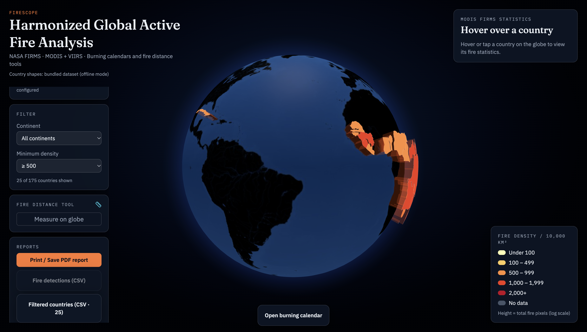

# FireScope
### Harmonized Global Active Fire Analysis

**An Interactive Geospatial Application for Exploring Satellite-Detected Active Fires**

[](https://fire-scope-v1.vercel.app/)
[](https://firms.modaps.eosdis.nasa.gov/)
[](https://www.typescriptlang.org/)

**[Explore the Live Application →](https://fire-scope-v1.vercel.app/)**

---

## 1. Project Overview

FireScope is an interactive geospatial application designed to explore, analyze, and visualize global active-fire activity using satellite-derived observations.

The application integrates country-level fire statistics and live satellite-detected active-fire observations into an interactive 3D globe. It enables users to investigate geographic fire patterns, compare satellite observations, explore seasonal burning trends, and examine the spatial relationships between fire detections and selected locations.

FireScope combines two complementary data pathways:

- **Country Analysis Layer:** A bundled GeoJSON FeatureCollection containing country geometries and precomputed fire-related indicators.
- **Active-Fire Observation Layer:** Date-specific satellite detections retrieved server-side through the NASA Fire Information for Resource Management System (FIRMS) API.

These layers serve different analytical purposes. The country analysis layer provides a broad statistical overview, while the FIRMS observation layer provides selectable satellite detections for a requested date range.

Importantly, the bundled country-level indicators are not recalculated from the currently selected FIRMS query. The two datasets should therefore be interpreted independently.

## 2. Scientific and Analytical Scope

FireScope focuses on the spatial and temporal exploration of satellite-observed active-fire signals.

An active-fire detection represents a satellite observation flagged by a sensor's active-fire detection algorithm. It does not necessarily represent an individual fire, a complete burned area, a fire perimeter, or the full duration and impact of a fire event.

The application supports six primary analytical dimensions:

| Dimension | Description |
|---|---|
| Spatial Distribution | Country-level fire totals and area-normalized fire density visualized on a global 3D globe. |
| Temporal Distribution | Monthly burning calendars and year-to-year comparisons for selected months. |
| Sensor Comparison | Separate observation views for MODIS and VIIRS products, including individual satellite platforms. |
| Fire Radiative Power | FRP measurements associated with individual detections, expressed in megawatts (MW). |
| Day/Night Context | Daytime and nighttime acquisition indicators supplied by FIRMS observation records. |
| Proximity Analysis | Great-circle distance measurement and nearby detection counts within a configurable buffer around a user-defined line. |

These capabilities are intended for exploratory analysis, research communication, and geospatial visualization.

FireScope is not a validated operational fire-warning system and should not replace ground observations, official fire-monitoring services, or specialist fire products.

## 3. Satellite Data Sources

### 3.1 NASA FIRMS

FireScope retrieves active-fire observations through the official NASA FIRMS Area API.

The implementation supports the following satellite platforms and product identifiers:

| Sensor Family | Satellite Platform | FIRMS Product Identifiers |
|---|---|---|
| MODIS | Terra | `MODIS_SP`, `MODIS_NRT` |
| MODIS | Aqua | `MODIS_SP`, `MODIS_NRT` |
| VIIRS | Suomi NPP | `VIIRS_SNPP_SP`, `VIIRS_SNPP_NRT` |
| VIIRS | NOAA-20 | `VIIRS_NOAA20_SP`, `VIIRS_NOAA20_NRT` |
| VIIRS | NOAA-21 | `VIIRS_NOAA21_SP`, `VIIRS_NOAA21_NRT` |

### 3.2 Product Selection

For each requested sensor and date, FireScope checks the availability of the corresponding FIRMS products.

The application follows this selection strategy:

1. Prefer the science-quality archive product when the requested date falls within its available coverage.
2. Fall back to the corresponding Near Real-Time (NRT) product when the archive product is unavailable and NRT coverage exists.
3. Return no detections for a source when neither product provides coverage for the requested date.

The available source filters include:

- Combined MODIS
- Terra
- Aqua
- Combined VIIRS
- Suomi NPP
- NOAA-20
- NOAA-21
- Harmonized (MODIS + all supported VIIRS platforms)

The Harmonized option requests observations from MODIS and all three supported VIIRS platforms before applying the application's de-duplication procedure.

**Official Data Source:** [NASA Fire Information for Resource Management System (FIRMS)](https://firms.modaps.eosdis.nasa.gov/)

## 4. MODIS–VIIRS Harmonization Approach

MODIS and VIIRS differ in sensor characteristics, spatial resolution, observation systems, and detection capabilities.

To provide a combined visualization layer, FireScope implements a deterministic spatial-temporal de-duplication heuristic.

This approach is intended to reduce potentially overlapping observations in the combined display. It is not a radiometric calibration procedure, cross-sensor retrieval correction, or scientifically validated event-matching model.

### 4.1 Harmonization Workflow

The current implementation follows five steps:

**Step 1 — Field Normalization**

FIRMS CSV records are mapped into a shared data structure containing:

- Latitude and longitude
- Fire Radiative Power (FRP)
- Day/night acquisition flag
- Acquisition date and time
- Satellite platform
- Sensor family
- Source product identifier

**Step 2 — Spatial-Temporal Cell Assignment**

Each observation is assigned a comparison key based on:

- Acquisition date
- Two-hour UTC time bin
- Latitude rounded to two decimal places
- Longitude rounded to two decimal places

This creates an approximate spatial grid of 0.01° resolution. The corresponding ground distance of a longitude interval varies with latitude.

**Step 3 — Potential Duplicate Identification**

Observations sharing the same comparison key are treated as potential duplicates.

**Step 4 — Deterministic Record Selection**

When multiple records occupy the same comparison cell:

- VIIRS is preferred over MODIS when observations from both sensor families compete.
- When records from the same sensor family compete, the observation with the higher FRP is retained.

**Step 5 — Source-Level Preservation**

Users can switch back to individual sensor families and satellite platforms to inspect their original observation views independently of the combined layer.

### 4.2 Harmonization Limitations

The number of removed records is exposed through the live-fire status and report data.

Because the procedure relies on rounded coordinates and fixed time bins, it may:

- Merge nearby but distinct detections.
- Fail to match observations representing the same fire event.
- Introduce differences in the number of displayed detections between individual and combined sensor views.

Consequently, the procedure should be described as **likely duplicate removal**, rather than definitive fire-event identification or cross-sensor equivalence.

## 5. Country-Level Fire Indicators

FireScope includes a precomputed country-level analysis dataset:

`public/data/firms_country_analysis.geojson`

The current bundled GeoJSON FeatureCollection contains 192 country or territory features.

Each feature includes geographic geometry and selected fire-related indicators.

| Indicator | Description |
|---|---|
| `total_fire_pixels` | Total fire-pixel count in the supplied country analysis dataset. |
| `fire_density_per_10k_km2` | Fire-pixel density normalized per 10,000 km². |
| `peak_burning_month` | Month with the highest recorded burning activity in the supplied analysis. |
| `season_duration_months` | Fire-season duration, expressed in months. |
| `autocorr_12month` | Twelve-month autocorrelation indicator, where available. |
| `mean_frp_mw` | Mean Fire Radiative Power, expressed in MW. |
| `max_frp_mw` | Maximum Fire Radiative Power, expressed in MW. |
| `daytime_fire_pct` | Percentage of detections classified as daytime observations. |
| `area_km2` | Country or territory area, expressed in km². |

### 5.1 Dataset Provenance

The GeoJSON file is consumed as a precomputed input.

The current repository does not include:

- A reproducible country-statistics generation pipeline.
- A documented source-period manifest.
- A complete provenance record for every indicator.
- Independently documented processing definitions and dataset versioning.

Therefore, these values should be referenced as belonging to the bundled country analysis dataset until their upstream sources, temporal coverage, and processing methodology are independently documented.

Missing values are represented as unavailable rather than being inferred or replaced with zero.

## 6. Temporal Analysis and Geographic Aggregation

FireScope provides burning-calendar functionality across three geographic scopes.

### 6.1 Geographic Scopes

| Scope | Aggregation Method |
|---|---|
| Country | Detections are spatially filtered against the selected country's GeoJSON geometry. |
| Continent | Detections are retrieved within a regional bounding box and subsequently filtered against the country geometries belonging to the selected continent. |
| World | Detections are counted globally without country-boundary clipping. |

### 6.2 Timeline Processing

The timeline divides longer requests into smaller windows of no more than five days, following the request-window limit used by the FIRMS Area API workflow.

Completed windows are accumulated progressively and cached within the browser session to reduce repeated API requests.

### 6.3 Temporal Sampling Considerations

The application uses different sampling strategies depending on the geographic scope.

| Analysis | Country | World / Continent |
|---|---|---|
| Monthly Burning Calendar | Full selected year | First day of each month |
| Historical Month Comparison | Full selected month for each year | First five days of the selected month in each year |

This distinction is important when interpreting temporal results.

World and continent samples are not complete monthly or annual totals. They should not be compared directly with full-period country-level results as though they represented equivalent observation windows.

## 7. Interactive Features

FireScope integrates geospatial visualization, satellite data exploration, temporal analysis, and reporting functionality.

### 7.1 Global Geospatial Visualization

- Interactive 3D globe with country selection.
- Country hover information and fire indicators.
- Country-level fire-density classification.
- Continent and minimum-density filtering.

### 7.2 Live Satellite Fire Monitoring

- Live FIRMS observation retrieval for selected dates.
- Configurable observation windows ranging from one to five days.
- MODIS and VIIRS source selection.
- Individual satellite platform filtering.
- Harmonized multi-sensor observation view.

### 7.3 Temporal and Historical Analysis

- Country-level burning calendars.
- Continent-level burning calendars.
- Global burning calendars.
- Historical comparisons across available years.
- Monthly and year-to-year fire activity exploration.

### 7.4 Fire Measurement and Proximity Analysis

- Two-point geographic line measurement.
- Great-circle distance calculation in kilometres.
- Configurable buffer distance around the measured line.
- Counting displayed fire detections within the selected buffer.

### 7.5 Reporting and Data Export

- CSV export for supported report data.
- Print-oriented report view.
- Harmonization statistics and removed-record reporting.

## 8. Data Limitations and Interpretation

FireScope is an exploratory research and visualization prototype. Its outputs should be interpreted within the limitations of satellite active-fire observations, source data, and implemented analytical procedures.

### 8.1 Active-Fire Detection Limitations

Active-fire detections are satellite observations, not direct counts of individual fires.

A single fire may produce multiple detections, while some fires may remain undetected due to cloud cover, observation timing, sensor resolution, or detection thresholds.

### 8.2 Cross-Sensor Harmonization Limitations

The MODIS–VIIRS harmonization procedure is a deterministic de-duplication heuristic.

It is not a sensor-calibration method, a validated event-matching algorithm, or a reconstruction of individual fire events.

### 8.3 Visualization Limits

The live globe limits the number of plotted points to 60,000 per request.

Consequently:

- The source response total may exceed the displayed point count.
- When the source response exceeds the display limit, the plotted observations represent a sampled subset.
- The number of plotted points should not be interpreted as the total number of source detections.

### 8.4 Temporal Sampling Limitations

Country, continent, and world burning calendars use different temporal sampling strategies.

Regional samples must not be interpreted as complete monthly or annual totals.

### 8.5 Country Dataset Provenance

The bundled country-level GeoJSON does not currently include a complete provenance manifest or documented temporal coverage.

Its indicators should not be combined with live FIRMS observations as if both datasets shared the same processing period or analytical methodology.

### 8.6 Missing Values

An unavailable indicator represents missing information in the input dataset. It does not indicate zero fire activity.

### 8.7 Distance and Proximity Analysis

Distance measurement and nearby-detection calculations are geometric summaries.

They do not estimate fire propagation, fire-spread direction, threat levels, or wildfire risk.

### 8.8 Research Recommendations

For reproducible research, record the following information alongside exported results:

- Query date.
- Selected satellite product.
- Requested date range.
- Geographic scope.
- Selected satellite platform.
- Harmonization setting.
- Source-product identifiers.
- Temporal sampling method.

Important findings should be verified against original NASA product documentation, ground observations, and relevant ancillary datasets before being used for operational or scientific conclusions.

## 9. Technical Architecture

FireScope is a TypeScript-based web application built around a modern geospatial visualization and server-side data retrieval architecture.

### 9.1 Technology Stack

| Technology | Purpose |
|---|---|
| React | Component-based user interface. |
| TypeScript | Type-safe application development. |
| TanStack Start | Full-stack application framework and server functions. |
| TanStack Router | Application routing. |
| Vite | Development server and production build tooling. |
| globe.gl | Interactive 3D globe visualization. |
| Three.js | 3D rendering engine. |
| D3 Geo | Geographic bounds and point-in-polygon operations. |
| GeoJSON | Country geometries and country-level attributes. |
| Zod | Server-function input validation. |
| NASA FIRMS API | Satellite-derived active-fire observations. |

### 9.2 Data Flow

The application follows a server-mediated data retrieval workflow.

1. The browser requests active-fire data through TanStack server functions.
2. Server functions validate incoming parameters using Zod.
3. The server accesses NASA FIRMS using the configured API key.
4. Retrieved observations are normalized and processed.
5. Harmonization is applied when the combined source is selected.
6. Processed observations are returned to the browser for visualization and analysis.

Country geometries and precomputed indicators are loaded from the bundled GeoJSON file by default.

An optional FastAPI-compatible backend can provide country and statistics endpoints. If the external backend is not configured or becomes unavailable, FireScope falls back to the bundled country GeoJSON for its country analysis layer.

### 9.3 Environment and API Security

The NASA FIRMS API key is accessed server-side and must never be exposed through a browser-visible environment variable.

In particular, do not prefix the FIRMS API key with `VITE_`.

## 10. Run Locally

### 10.1 Requirements

Before running FireScope locally, ensure that the following are installed:

- Node.js (an active LTS release is recommended).
- npm.
- A NASA FIRMS MAP_KEY for live active-fire queries.

### 10.2 Installation

Clone the repository:

```bash
git clone https://github.com/deluluscientist/FireScope.v1.git
```

Navigate to the project directory:

```bash
cd FireScope.v1
```

Install dependencies:

```bash
npm install
```

Start the development server:

```bash
npm run dev
```

Open the local URL provided by Vite in your terminal.

### 10.3 Environment Configuration

Configure the following environment variables in your local or deployment environment.

| Variable | Runtime | Required | Description |
|---|---|---|---|
| `FIRMS_MAP_KEY` | Server-side | Yes, for live FIRMS queries | Authenticates requests to NASA FIRMS. Must remain server-side. |
| `VITE_API_BASE_URL` | Browser-visible | No | Optional base URL for the external FastAPI-compatible country/statistics API. Leave empty to use the bundled GeoJSON country layer. |

The repository includes an `.env.example` file for the optional public API base URL.

Add `FIRMS_MAP_KEY` separately as a server-side environment variable.

**Never commit API keys or other secrets to the Git repository.**

### 10.4 Build, Test, and Lint

Build the production application:

```bash
npm run build
```

Preview the production build:

```bash
npm run preview
```

Run tests:

```bash
npm test
```

Run linting:

```bash
npm run lint
```

## 11. Deployment

FireScope is deployed on Vercel.

**Live Application:** https://fire-scope-v1.vercel.app/

### 11.1 Vercel Environment Configuration

For live FIRMS functionality:

1. Open the FireScope project in Vercel.
2. Navigate to Project Settings → Environment Variables.
3. Add `FIRMS_MAP_KEY` as a server-side environment variable.
4. If using an external country/statistics API, configure `VITE_API_BASE_URL`.
5. Redeploy the application to apply the updated environment configuration.

The FIRMS API key must remain server-side and must never be exposed to the browser.

## 12. Repository Structure

```text
FireScope.v1/
│
├── public/
│   └── data/
│       └── firms_country_analysis.geojson
│
├── src/
│   ├── components/
│   │   └── Globe, filters, panels, calendar, reports
│   │
│   ├── hooks/
│   │   └── Country, timeline, and fire-data hooks
│   │
│   ├── lib/
│   │   └── FIRMS access, harmonization, geometry, reports
│   │
│   ├── routes/
│   │   └── TanStack Start application routes
│   │
│   ├── services/
│   │   └── Optional external API client
│   │
│   └── types/
│       └── Shared TypeScript data contracts
│
├── .env.example
├── package.json
└── README.md
```

## 13. Research and Development Status

The current implementation provides an integrated environment for global active-fire exploration through interactive geospatial visualization, satellite-source selection, heuristic cross-sensor de-duplication, regional temporal analysis, proximity measurement, and report-oriented data export.

### 13.1 Current Capabilities

- Interactive global 3D fire visualization.
- Country-level fire statistics and density indicators.
- NASA FIRMS active-fire data retrieval.
- MODIS and VIIRS satellite observation comparison.
- Multi-platform harmonized observation visualization.
- Spatial-temporal de-duplication.
- Country, continent, and world burning calendars.
- Historical monthly comparisons.
- Geographic distance and proximity analysis.
- CSV export and print-oriented reporting.

### 13.2 Planned Improvements

Future development will focus on improving scientific reproducibility, data quality, and analytical capabilities.

Planned improvements include:

- Comprehensive provenance documentation for the bundled country-level dataset.
- Reproducible preprocessing scripts for country-level fire indicators.
- Validation and evaluation of cross-sensor matching strategies.
- Expanded historical comparison capabilities.
- Enhanced report generation and data export options.
- Improved documentation of temporal sampling and analytical assumptions.

## 14. Acknowledgements and Data Attribution

FireScope uses satellite active-fire observations accessed through the official NASA Fire Information for Resource Management System (FIRMS).

**Primary Data Source:** [NASA FIRMS](https://firms.modaps.eosdis.nasa.gov/)

**Project Repository:** [GitHub – FireScope.v1](https://github.com/deluluscientist/FireScope.v1)

**Live Application:** [FireScope](https://fire-scope-v1.vercel.app/)

FireScope is an independent research and visualization project. It is not developed, operated, or endorsed by NASA. NASA FIRMS is acknowledged as the source of the satellite observation service used by this application.

---

<p align="center">
  <strong>FireScope — Exploring Global Fire Activity Through Satellite Data and Geospatial Analysis.</strong>
</p>

<p align="center">
  <a href="https://fire-scope-v1.vercel.app/">Open FireScope →</a>
  &nbsp; | &nbsp;
  <a href="https://github.com/deluluscientist/FireScope.v1">View Source Code →</a>
</p>
